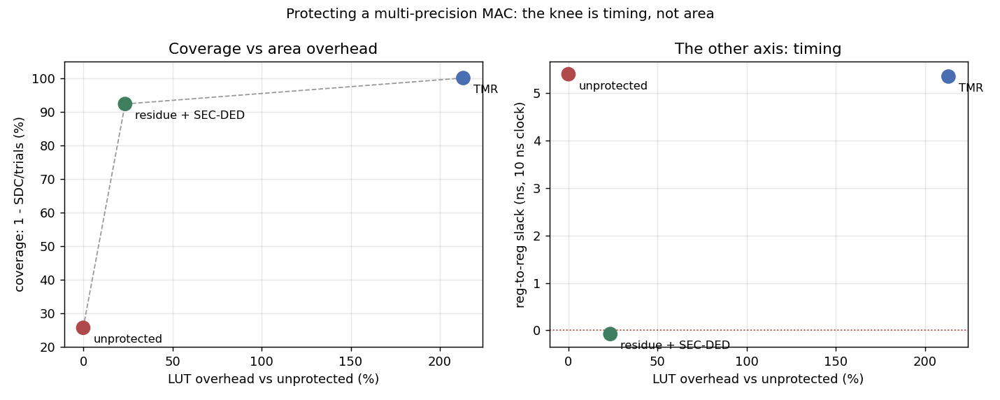

# Protecting a multi-precision MAC — design, campaign, and overhead

Concurrent error detection and correction wrapped around a multi-precision
multiply-accumulate datapath, characterised against an unprotected baseline and
against triple-modular redundancy.

Reproduces from a clean clone with Yosys, Verilator, SymbiYosys and z3 on
`PATH` (Vivado additionally for the FPGA numbers):

```bash
python3 model/protect.py                      # protection algebra self-check
verilator --binary --timing -sv rtl/*.v tb/dut_wrap.v tb/tb_mpmac.v \
  --top-module tb_mpmac -o sim -DDUT=dut_prot \
  -Wno-DECLFILENAME -Wno-TIMESCALEMOD -Wno-WIDTHTRUNC -Wno-WIDTHEXPAND
./obj_dir/sim                                 # 1,467,310 fault-free vectors
./sweep_prot.sh                               # Yosys area/depth
cd formal && sby -f equiv_acc.sby             # accumulate path proved equivalent
cd ../fpga && vivado -mode batch -source ooc.tcl
```

## The scheme

Two layers, because detection and correction are different jobs.

**Residue mod 3** checks the whole multiply-accumulate concurrently. Residues
are homomorphic over `×` and `+`, so carrying a 2-bit residue alongside the
datapath and comparing at the end checks the entire arithmetic path for a few
percent of a duplicate. Mod 3 specifically, because `4^k = 1 (mod 3)` makes the
residue of a binary number the sum of its 2-bit groups — a small adder tree,
where most other moduli need a divider.

**Hamming SEC-DED** protects the 48-bit accumulator file: 48 data + 6 check + 1
overall parity = 55 bits stored. The accumulator is the widest, longest-lived
state in the block, so it is both the likeliest place for a transient to land
and the cheapest place to actually repair one.

TMR is built too, but only as a reference point at the top of the overhead axis.

### The check, in the form the hardware computes it

```
U_next = U_acc + U_p - c·2^w                     (lane add, w even)
U_p    = V_p + s_p        (mod 3)                (V_p = a·b, s_p = sign bit)
⇒  r(U_next) = r(U_acc) + r_a·r_b + s_p − c      (mod 3)
```

Two terms are easy to miss and both are load-bearing. `s_p` accounts for the
product's sign, because a lane holds a two's complement pattern whose value is
`U_p − s_p·2^w`. `c` accounts for the accumulator wrap, which discards `2^w ≡ 1`.
Drop either and the checker fires on every negative product or every wrap.
`model/protect.py` reports zero false alarms across 560,000 fault-free
lane-cycles only once both are present.

Residues are built once at 4-bit (operand) and 12-bit (accumulator) granularity
and summed upward, since `2^4 ≡ 2^12 ≡ 1 (mod 3)`. One set of narrow trees
serves all three modes instead of a separate set per width.

## Verification

| Check | Result |
|---|---|
| Protection algebra vs direct arithmetic | 560,000 lane-cycles, **0 false alarms** |
| `res3` residue trees vs reference | 12-bit exhaustive + 200k random at 24/48, 0 errors |
| SEC-DED single-error correction | **11,000/11,000** (all data, check and parity bits) |
| SEC-DED double-error detection | **169,200/169,200** flagged |
| `mpmac_unprot` vs golden model | 1,467,310 vectors, 0 errors |
| `mpmac_prot` vs golden model | 1,467,310 vectors, 0 errors, **no false alarms** |
| `lane_acc` ≡ `seg_add48` | `sby` + z3: **PASS**, exhaustive |

The fault-free check matters as much as the fault campaign: a checker that
fires on correct arithmetic is worse than no checker, and a protection scheme
that silently changes the answer is worse still. Both designs run the arith
track's own golden-model testbench unmodified via tie-off wrappers.

The accumulate path was rebuilt (`lane_acc` instead of `seg_add48`) so it could
expose the per-lane carry the residue check needs, so it is *proved* equivalent
rather than assumed. Proving that on the whole sequential MAC did not close in
ten minutes; proving the one block that actually differs closes in under a
second. Choosing the granularity was the whole difference.

## Fault model

Transient single-event upset: one bit flips for one cycle, one fault per trial.
Not stuck-at — that is a manufacturing model, and the interesting question here
is operational. Every trial runs a clean copy and an injected copy in lockstep
on identical stimulus, and lands in exactly one bucket:

| Bucket | Meaning |
|---|---|
| **masked** | output correct, no flag — the fault died on its own |
| **corrected** | output correct, checker fired — protection repaired it |
| **detected** | output wrong, checker fired — safe failure, a system can retry |
| **escaped (SDC)** | output wrong, no flag — **silent data corruption** |

Only the last is a real failure. A single "coverage" number hides the
masked/detected split, which is exactly the split IEC 61508 scores differently,
so all four are reported.

## Campaign results

4000 trials per site per design, 16,000 trials each.

**Protected** (`results/campaign_mpmac_prot.txt`):

| site | trials | masked | corrected | detected | escaped | escape % |
|---|---|---|---|---|---|---|
| ACC (accumulator bits) | 4000 | 0 | **4000** | 0 | **0** | 0.00% |
| ECC (stored check bits) | 4000 | 0 | **4000** | 0 | **0** | 0.00% |
| OPA (operand register) | 4000 | 115 | 0 | 2651 | 1234 | **30.85%** |
| PROD (product output) | 4000 | 0 | 0 | **4000** | **0** | 0.00% |

**Unprotected baseline** (`results/campaign_mpmac_unprot.txt`):

| site | escaped | escape % |
|---|---|---|
| ACC | 4000 | **100.00%** |
| OPA | 3885 | 97.12% |
| PROD | 4000 | **100.00%** |

Every single-bit flip in the accumulator is repaired outright, and the flag
latency is 0 cycles — the SEC-DED decode sits in front of the accumulator read,
so a transient is repaired before it can accumulate into the running total.

### The prediction that was wrong, and what replaced it

The scheme was written down with a prediction: accumulator faults detected
~100%, and *combinational* faults escaping "roughly one time in three". The
first half held. The second half was wrong — combinational faults at the
product output escaped **0 times in 4000**.

The prediction split faults by *location*. The right axis is *linearity*:

- **Additive faults** — accumulator bits, product-output bits, adder-tree nodes
  — reach the accumulated value as `±2^k`. Since `2^k mod 3` alternates 1, 2 and
  is never 0, mod 3 catches **every one of them**. An adder tree cannot turn a
  single-bit fault into a multiple of 3, however deep it is.
- **Multiplicative faults** — anything upstream of the multiply — reach the sum
  as `2^k × (other operand)`, which is divisible by 3 exactly when that operand
  is. That is the *only* way a single fault escapes mod 3, and it happens about
  a third of the time.

Measured 30.85% against a predicted 34%; excluding the 115 masked trials (where
the other operand was zero, so the flip changed nothing) it is 31.8%. The model
in `model/protect.py` was corrected to match this reasoning rather than the
campaign being explained away.

This is the useful result. "Where is the fault?" is the wrong question to ask of
a residue checker. "Does the fault reach the sum linearly?" is the right one.

## Overhead

Yosys 0.68 + ABC, generic cells:

| design | cells (ABC) | FF | logic | depth | vs unprotected |
|---|---|---|---|---|---|
| `mpmac_unprot` | 4711 | 48 | 4663 | 323 | — |
| `mpmac_prot` | 7066 | 55 | 7011 | 554 | **+50%** |
| `mpmac_tmr` | 15488 | 144 | 15344 | 346 | +229% |

Vivado 2025.2, `xc7a100tcsg324-1`, out-of-context, LUT-only, 10 ns clock:

| design | LUT | FF | CARRY4 | WNS reg→reg | WNS worst | power (W) |
|---|---|---|---|---|---|---|
| `mpmac_unprot` | 1525 | 48 | 266 | +5.397 | −7.686 | 0.106 |
| `mpmac_prot` | **1883** | 55 | 273 | **−0.078** | −14.155 | 0.123 |
| `mpmac_tmr` | 4775 | 144 | 798 | +5.348 | −7.967 | 0.152 |

Power is a **vectorless** estimate — no switching-activity file, so the figures
are only meaningful against each other, not as absolute numbers. On that basis
protection costs +16% power against TMR's +43%, which tracks the area ratio
rather than adding anything new.

**On real fabric the protection costs +23.5% LUTs against TMR's +213%** — a 9×
cheaper way to buy most of the coverage, and +16% power against +43%. That is the low-overhead claim made
concrete on hardware someone else can re-synthesise.

### The knee is timing, not area



| design | LUT overhead | coverage | reg→reg slack |
|---|---|---|---|
| unprotected | — | 25.72% | +5.397 ns |
| residue + SEC-DED | +23.5% | **92.29%** | **−0.078 ns** |
| TMR | +213.1% | 100.00% | +5.348 ns |

Area is the axis everyone quotes and it is not where this scheme hurts. The
SEC-DED decode sits inside the accumulator feedback loop, so the reg-to-reg
path goes from 5.40 ns of slack to −0.08 ns — the protected design *misses* a
10 ns clock that the unprotected one meets by half a cycle. TMR, which costs
three times the area, barely moves timing at all because voting is wide but
shallow.

So the honest trade is not "cheap versus expensive". It is **area versus
depth**: TMR buys full coverage with area, residue+SEC-DED buys 92% of it with
timing. Which one is right depends on whether the design is area-limited or
frequency-limited, and that is a property of the system, not of the scheme.

The fix, if frequency matters, is to pipeline the ECC decode out of the loop —
storing the accumulator pre-decoded and correcting off the critical path. That
is a real design change, not a tuning knob, and it is not done here.

## Honest limits

- **Single faults only.** One flip per trial. The scheme is a single-error
  scheme, so double-fault campaigns would mostly re-derive that fact.
- **No fault-rate model.** Faults are injected at a chosen rate; mapping that to
  FIT from device data is a separate project.
- **The residue checker detects; it does not locate.** A mismatch says the
  arithmetic is wrong, not which lane or which bit. For a retry-capable system
  that is enough; for a repair-in-place system it is not.
- **Operand-side coverage is ~69% and cannot be improved by a bigger modulus
  alone.** Escapes are multiples of 3; mod 7 or mod 15 would move the fraction
  but not the mechanism, and would cost a real divider-free tree only for
  moduli of the form `2^n − 1`.
- **No place-and-route.** Post-synthesis timing only, and the CARRY4 story
  especially will move.
- **Phase 2 is not started** — no on-demand controller, no graceful degradation
  against fault density, no approximate-arithmetic study.

## Layout

| Path | What |
|---|---|
| `model/protect.py` | protection algebra; residue and SEC-DED proved before RTL |
| `model/mpmac_core.py` | datapath golden model (vendored) |
| `rtl/res3.v` | mod-3 residue trees |
| `rtl/secded.v` | Hamming SEC-DED encode/decode |
| `rtl/mpmac_prot.v` | product network, lane accumulate, checker, and the three designs |
| `rtl/adders.v`, `rtl/mpmac.v` | vendored datapath — see `rtl/PROVENANCE.md` |
| `tb/tb_mpmac.v`, `tb/dut_wrap.v` | fault-free verification against the golden model |
| `tb/tb_campaign.v` | the injection campaign |
| `formal/equiv_acc.sby` | `lane_acc` ≡ `seg_add48` |
| `sweep_prot.sh`, `fpga/ooc.tcl` | the overhead tables |
| `results/` | campaign output, plot, and the script that draws it |
