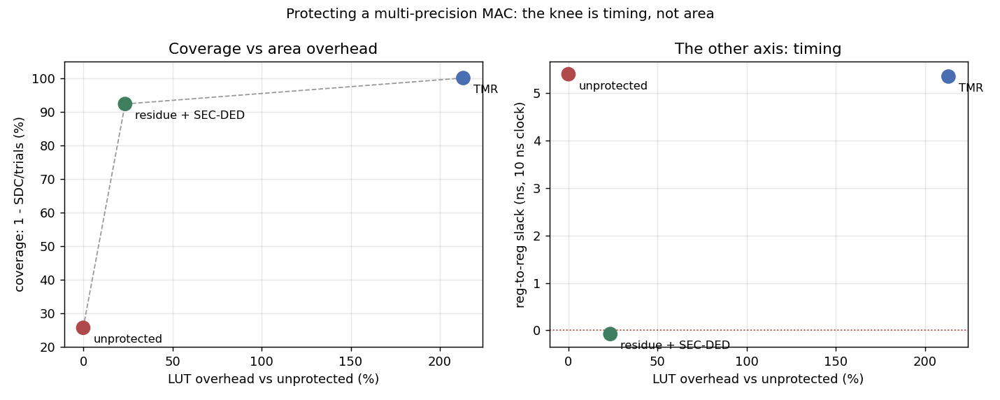
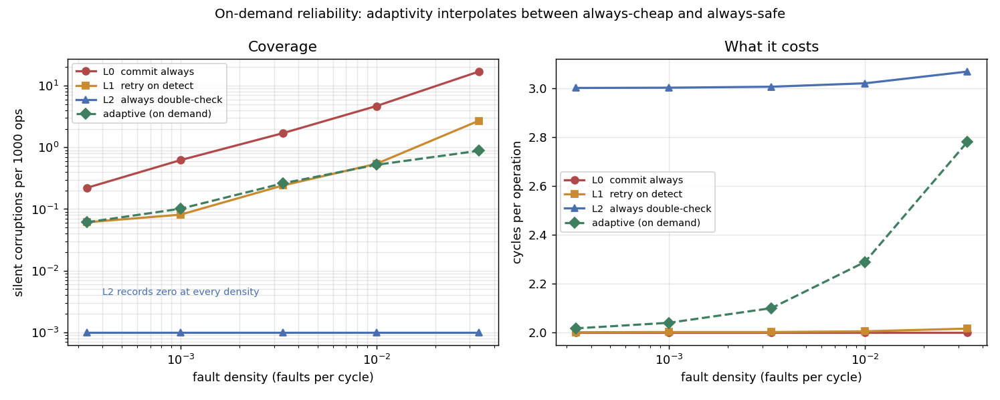
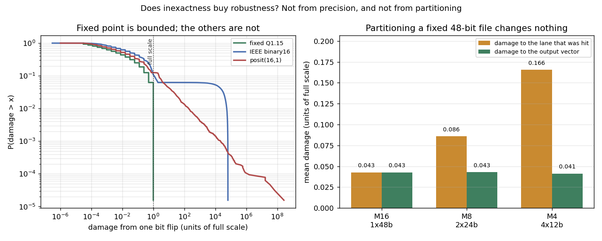

# fault-tolerant-datapath

Concurrent error detection and correction for a multi-precision multiply-
accumulate datapath, measured against an unprotected baseline and against
triple-modular redundancy.

**Residue mod 3** checks the whole multiply-accumulate concurrently;
**Hamming SEC-DED** repairs the 48-bit accumulator file. TMR is built too, but
only to anchor the top of the overhead axis.

Full design notes, campaign results and analysis: **[DESIGN.md](DESIGN.md)**.
The datapath being protected lives in
[multiprecision-datapath](https://github.com/devesh-b/multiprecision-datapath);
the injection primitive it borrows from is
[fault-injection-harness](https://github.com/devesh-b/fault-injection-harness).

## Results in brief

- **Every single-bit accumulator fault is repaired** — 4000/4000, zero silent
  corruptions, zero cycles of latency. Unprotected, the same faults corrupt the
  result 100% of the time.
- **+23.5% LUTs against TMR's +213%** on an Artix-7, for 92.3% coverage against
  TMR's 100%.
- **The knee is timing, not area.** The ECC decode sits in the accumulator
  feedback loop, so the protected design misses a 10 ns clock that the
  unprotected one meets with 5.4 ns to spare. TMR costs 3× the area and barely
  moves timing at all.
- **A prediction in the design notes turned out wrong, and the campaign said
  why.** Faults were split by location — accumulator, operand, combinational —
  and combinational ones were predicted to escape ~1/3 of the time. They escaped
  0 times in 4000. The right axis is not location but linearity: anything that
  reaches the sum as ±2^k is always caught, because 2^k is never divisible by 3.
  Only faults upstream of the multiply can escape.



## Phase 2 — on-demand reliability

A small fault-free controller measures fault density and picks a protection
level: retry-on-detect when things are quiet, execute-twice-and-compare when
they are not.

- **Double-execute records zero silent corruptions at every fault density
  tested** — temporal redundancy closes the blind spot residue mod 3
  structurally cannot reach.
- **The controller is 1.9% of the design** (142 cells against 7366), so
  triplicating it costs under 4% against 3.29× for triplicating everything.
  That is DeSyRe's premise as two numbers rather than an assertion.
- **Two results came out against the design.** Running unprotected is never
  worth it — the cheap level is so cheap it dominates, so the controller's floor
  had to be raised. And adaptivity does not beat a well-chosen fixed level: it
  reaches 67% of the coverage gain for 73% of the cost. Its value is not
  needing to know the fault density in advance.



## Does inexactness buy robustness?

Measured, because the claim gets repeated loosely. **No, on both counts.**

- **Fixed point's damage from a bit flip is structurally bounded by full scale;
  binary16 and posit are not.** Posit(16,1)'s worst case is 4000x worse than
  binary16's, because a corrupted regime field multiplies the value enormously.
  That *inverts* the accuracy ranking — posit buys accuracy near 1 with an
  encoding whose corruption is catastrophic.
- **Fewer bits is worse, by 64x from 16 to 4.** Fewer things to hit, but each
  one carries more of the value, and that dominates.
- **Partitioning the accumulator changes nothing.** Narrow lanes corrupt a
  smaller fraction of the output and do proportionally more damage inside it;
  measured on the RTL the two cancel at 0.040 either way, because lanes x
  lane-width is 48 regardless.

The bits are the cross-section. Inexactness buys area and throughput — it
should be argued for on those grounds, not on robustness it does not deliver.



## Requirements

- Yosys 0.68+ with ABC, SymbiYosys, z3 — all in the
  [OSS CAD Suite](https://github.com/YosysHQ/oss-cad-suite-build)
- Verilator 5.05+
- Python 3.10+ (standard library; matplotlib only to redraw the plot)
- Vivado 2025.2 for the FPGA numbers — optional

## Reproduce

```bash
python3 model/protect.py            # protection algebra self-check
./sweep_prot.sh                     # Yosys area/depth
cd formal && sby -f equiv_acc.sby   # accumulate path proved equivalent
```

Fault-free verification and the injection campaign, from the repository root:

```bash
verilator --binary --timing -sv rtl/adders.v rtl/mpmac.v rtl/res3.v \
  rtl/secded.v rtl/mpmac_prot.v tb/dut_wrap.v tb/tb_mpmac.v \
  --top-module tb_mpmac -o sim -DDUT=dut_prot \
  -Wno-DECLFILENAME -Wno-TIMESCALEMOD -Wno-WIDTHTRUNC -Wno-WIDTHEXPAND
./obj_dir/sim                       # 1,467,310 fault-free vectors

verilator --binary --timing -sv rtl/adders.v rtl/mpmac.v rtl/res3.v \
  rtl/secded.v rtl/mpmac_prot.v tb/tb_campaign.v \
  --top-module tb_campaign -o camp -DDUT=mpmac_prot \
  -Wno-DECLFILENAME -Wno-TIMESCALEMOD -Wno-WIDTHTRUNC -Wno-WIDTHEXPAND
./obj_dir/camp                      # 16,000 injection trials
```

Swap `-DDUT=mpmac_unprot` for the baseline, `mpmac_tmr` for the TMR reference.

## Licence

MIT.
